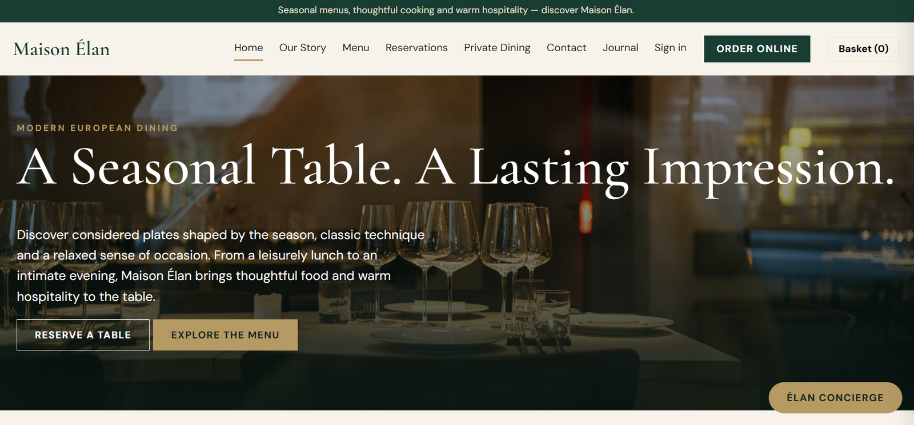
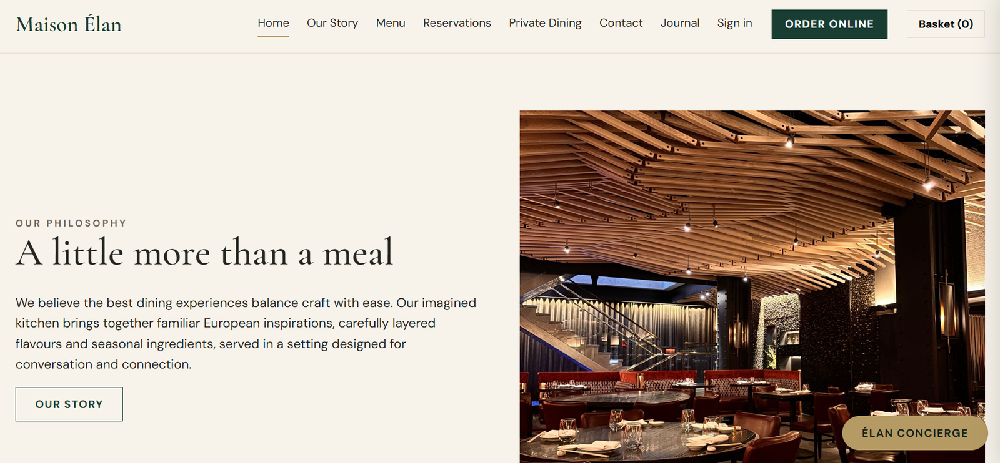
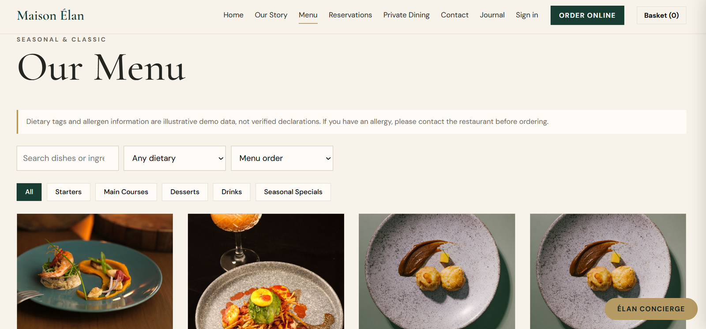
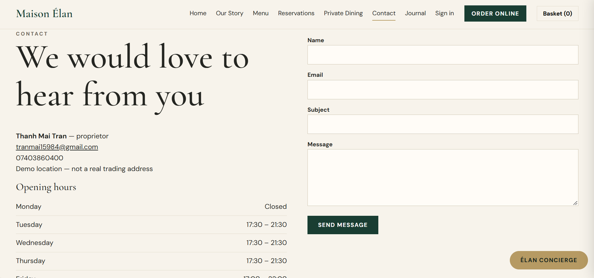
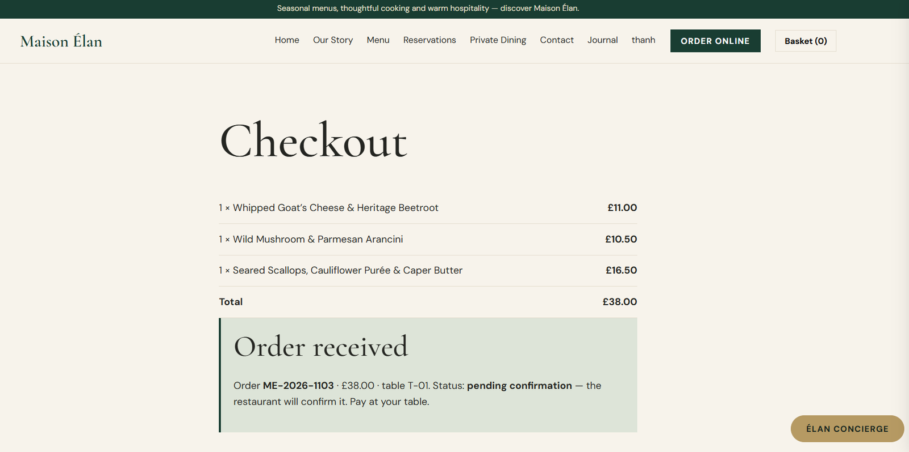
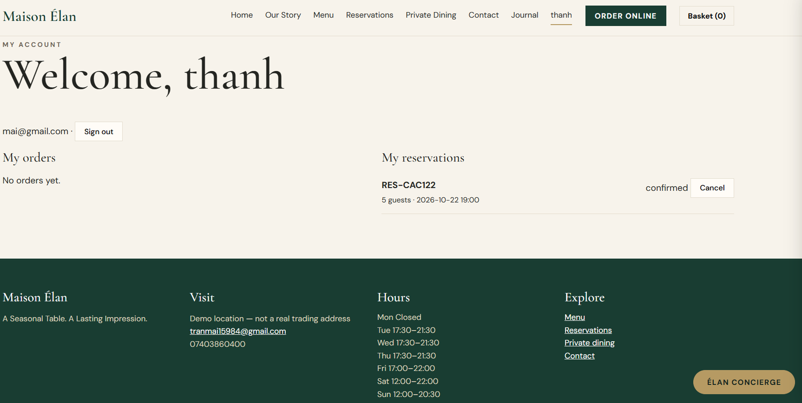
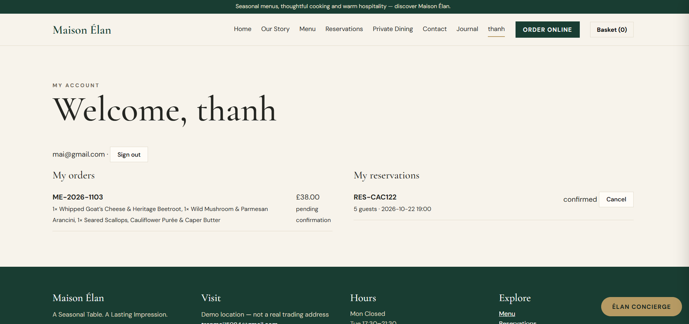
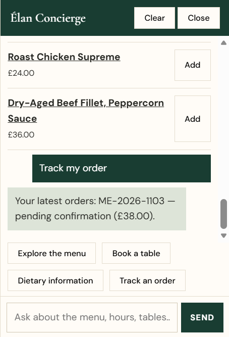
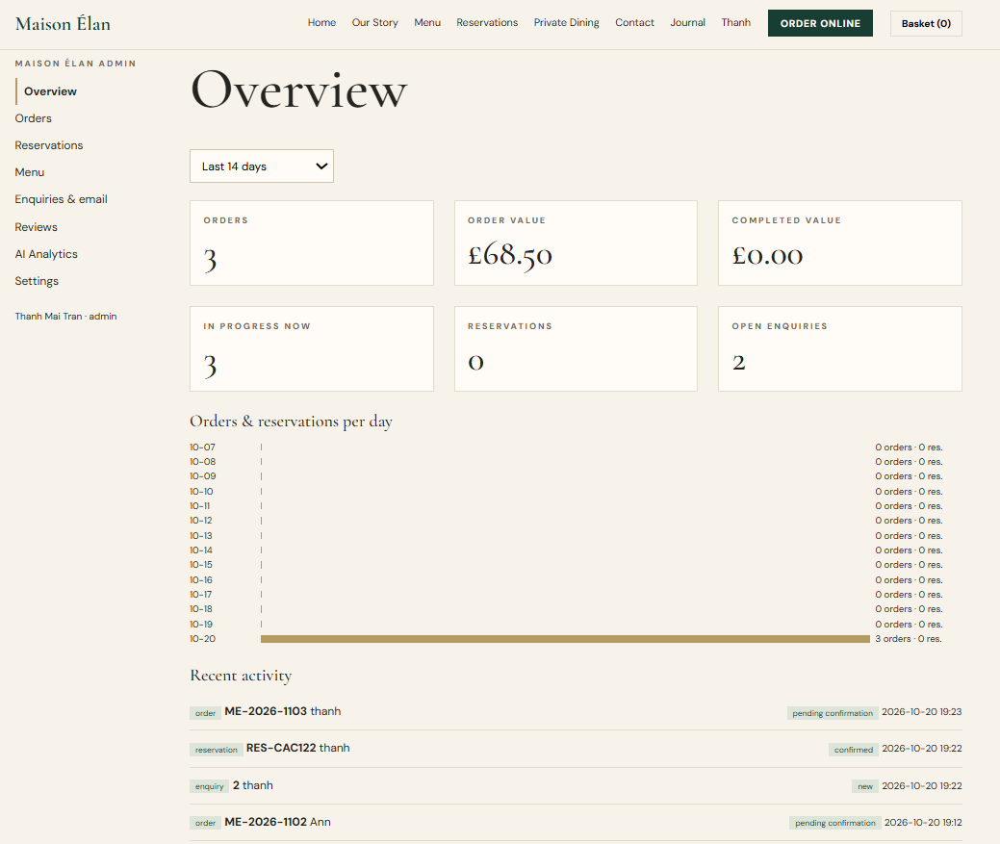

# Maison Élan — Restaurant Platform
<p align="center">
  <strong>An elegant restaurant experience, powered by modern web technology.</strong>
  <br><br>
  <a href="https://maison-elan-restaurant-platform.onrender.com/">🌐 Explore Live Demo</a>
</p>
A full-stack restaurant platform built as a portfolio project: public website, customer accounts, dine-in and collection ordering, table reservations, reviews, an admin dashboard and a rule-based AI Concierge. It runs with **no npm dependencies** on Node.js and SQLite.

> **Maison Élan is a fictional restaurant created for portfolio and educational purposes.** Menu items, prices, allergen records, bookings, orders and customer records are demonstration data. It is not a real booking or payment service.

## Demo
- **Local demo only** — no public deployment yet. Follow [Getting Started](#getting-started) to run it.
- **Source code:** this repository.
- **Screenshots:** see [Screenshots](#screenshots).

## Key Features
- **Menu:** 42 dishes with search, dietary filter, sorting, ingredients and allergen information (demo data).
- **Ordering:** dine-in orders to a table number or collection orders; prices calculated on the server; duplicate submissions ignored; price snapshots keep old orders unchanged.
- **Reservations:** live availability from opening hours and tables; conflict-safe booking; guests can cancel their own bookings.
- **Payments:** pay at table, pay on collection, and optional Visa/credit card or QR code through Stripe Checkout.
- **Accounts and reviews:** registration, login, order and reservation history; reviews with moderation and a verified-purchase check.
- **Admin dashboard:** overview with date range, order and reservation management, menu management, enquiries, review moderation, audit log.
- **AI:** rule-based concierge (menu, prices, hours, availability, order status, budget-based recommendations, policy answers with sources) and admin analytics built on fixed database queries.

## Tech Stack
| Area | Technology |
|---|---|
| Backend | Node.js (≥ 22.5), built-in `http` server, REST-style JSON API |
| Database | SQLite through the built-in `node:sqlite`; transactions, unique constraints, FTS5 for knowledge search |
| Frontend | Plain HTML, CSS and JavaScript single-page app (hash routing); Google Fonts; QR code library from cdnjs |
| Security | scrypt password hashing, HttpOnly + SameSite session cookies, custom-header check on state-changing requests, in-memory rate limiting, parameterised SQL |
| Payments | Stripe Checkout (hosted page) with signed-webhook handling |
| AI | Rule-based concierge, deterministic recommendation engine, optional local LLM (Ollama) for admin summaries |
| Testing | Automated API and integration tests written as plain Node scripts |
| Deployment | Dockerfile, environment-based configuration, persistent database volume |

## Architecture
```
Customer / Admin  (browser)
        |
        v
Web frontend  (frontend/public: index.html, app2.js, admin.js)
        |
        v
Node.js HTTP server  (server.js)
   |-- Menu, order, reservation, contact APIs      server.js
   |-- Accounts, sessions, reviews, journal,
   |   Concierge                                   extra.js
   |-- Dine-in orders and payment methods          payments.js
   |-- Admin APIs                                  admin-api.js
   |-- Recommendations, knowledge search,
   |   admin analytics                             ai.js
   |
   |-- (optional) Stripe: Checkout session out, signed webhook in
   |-- (optional) Ollama: local model rewrites analytics summaries
   v
SQLite database  (data/maison_elan.db, created and seeded on first start)
```
The site runs locally without Stripe or an LLM. Those integrations need separate configuration and verification.

## Screenshots
Captured from the application running locally.

**Home**




**Menu** — search, dietary filter, sorting and category tabs loaded from the database.



**Contact** — proprietor details, opening hours and enquiry form.



**Checkout** — order to table T-01, pay at the table; the order stays *pending confirmation* until staff accept it.



**Customer account** — reservations and orders for the signed-in guest.




**Élan Concierge** — a signed-in guest asks for the status of an order.



**Admin overview** — figures calculated from the database, per-day trend and recent activity.



## Getting Started
Requires Node.js ≥ 22.5. No `npm install` is needed.

PowerShell:
```powershell
$env:ADMIN_PASSWORD = "choose-a-strong-password"
npm start        # http://localhost:3000
```
macOS / Linux: `ADMIN_PASSWORD='choose-a-strong-password' npm start`

The SQLite database is created and seeded automatically on first start (default `data/maison_elan.db`, ignored by Git).

### Admin account and database
The admin account is created when the application starts against a database that does **not yet contain an admin user**. Set `ADMIN_EMAIL` and `ADMIN_PASSWORD` before that first start. If `ADMIN_PASSWORD` is not set, a random password is printed once in the server log. Sign in through **Sign in**, then open `#/admin`.

Changing `ADMIN_PASSWORD` later does **not** change the password of an existing admin. The application has no password-reset screen yet. For a local or test database, stop the server, remove the admin user, then start again with the new variables:
```powershell
$env:DB_PATH = "data/maison_elan.db"
node -e "const {DatabaseSync}=require('node:sqlite');const d=new DatabaseSync(process.env.DB_PATH);d.prepare('DELETE FROM sessions WHERE user_id IN (SELECT id FROM users WHERE role=?)').run('admin');d.prepare('DELETE FROM users WHERE role=?').run('admin')"
```
Alternatively delete the database file to start from scratch (this removes all orders, bookings and accounts). Keep development, test and production databases and credentials separate.

### Configuration
| Variable | Purpose |
|---|---|
| `PORT` | HTTP port (default 3000) |
| `DB_PATH` | SQLite file location |
| `ADMIN_EMAIL`, `ADMIN_PASSWORD` | Initial admin account (email defaults to `CONTACT_EMAIL`) |
| `OWNER_NAME`, `CONTACT_EMAIL`, `CONTACT_PHONE`, `ADDRESS` | Public contact details shown on the site (defaults are set in `server.js`) |
| `PUBLIC_URL` | Public base URL, used for payment redirects |
| `STRIPE_SECRET_KEY`, `STRIPE_WEBHOOK_SECRET` | Enable card and QR payments (webhook endpoint `/api/payments/webhook`, event `checkout.session.completed`) |
| `OLLAMA_URL`, `OLLAMA_MODEL`, `OLLAMA_TIMEOUT_MS` | Optional local LLM for admin analytics summaries |

### Docker
```
docker build -t maison-elan .
docker run -p 3000:3000 -e ADMIN_PASSWORD=... -v me_data:/data maison-elan
```
Serve over HTTPS in production and keep `/data` on a persistent volume.

## Testing
Use a throwaway database: the tests create accounts, orders, bookings and menu items.
```powershell
# terminal 1 — test server
$env:PORT="3100"; $env:DB_PATH="$env:TEMP\me_test.db"; $env:ADMIN_EMAIL="admin@test.dev"; $env:ADMIN_PASSWORD="AdminPass123"
$env:OLLAMA_URL="http://localhost:3199"; $env:OLLAMA_TIMEOUT_MS="1500"; npm start
# terminal 2
$env:PORT="3100"; npm test
```
`npm test` runs `tests/smoke.js`, `accounts.js`, `payments.js` and `admin-ai.js` (the last starts a mock Ollama on port 3199). To test the Stripe webhook logic, start a second server with `STRIPE_SECRET_KEY=sk_test_dummy STRIPE_WEBHOOK_SECRET=whsec_test` and run `HAS_STRIPE=1 node tests/payments.js` against it. These tests use simulated events and make no call to Stripe.

## Feature Status
| Label | Meaning |
|---|---|
| **Verified — Automated tests** | Covered by the test scripts above; the suite passed in the development environment (re-run `npm test` to reproduce) |
| **Verified — Browser** | Seen working in a browser (see screenshots) |
| **Implemented — Not fully verified** | Code written; not fully checked |
| **Planned** | Not built |

| Feature | Status |
|---|---|
| Menu, search, filters, dish detail | Automated tests; menu page checked in a browser. Dish detail page not yet checked in a browser |
| Collection and dine-in orders, server-side pricing, idempotent submit, price snapshots | Automated tests; dine-in checkout with pay at table checked in a browser |
| Reservations (availability, conflict-safe booking, cancel own booking) | Automated tests; a confirmed booking is shown in the account page in a browser. The booking form itself is not yet checked in a browser |
| Accounts (register, login, sessions, order and reservation history) | Automated tests; account page checked in a browser |
| Reviews (moderation, published-only averages, verified purchase) | Automated tests. Review form not yet checked in a browser |
| Contact and private dining enquiries | Automated tests; contact page checked in a browser. Private dining page not yet checked in a browser |
| Journal | Automated tests. Pages not yet checked in a browser |
| Admin dashboard | Automated tests (API); **Overview** page checked in a browser. Orders, reservations, menu, enquiries, reviews, AI and settings tabs not yet checked in a browser |
| Élan Concierge (rule-based, recommendations, policy answers) | Automated tests; order-status chat checked in a browser |
| AI admin analytics | Automated tests with a mock LLM. A real Ollama model has not been tested; admin AI page not yet checked in a browser |
| Pay at table / pay on collection | Automated tests; pay at table checked in a browser |
| Stripe Checkout (card) and QR payment | **Implemented — Not fully verified.** Simulated webhook signature, replay and amount checks pass in automated tests. A live Stripe Checkout, end-to-end payment confirmation and QR rendering have not been verified |
| Emails | **Planned.** Messages are stored in the `email_outbox` table; no email provider is configured and nothing is sent |
| LLM-driven concierge, tool calling, embeddings | **Planned** |

### Notes on payments
Simulated webhook tests prove that the server verifies signatures, ignores repeated events and checks amount and currency. They are **not** equivalent to a real Stripe transaction. Before accepting real payments: test with Stripe test keys, complete a test payment end to end, confirm the webhook is delivered to your public URL, and review Stripe's requirements. Card details never reach this server; customers pay on Stripe's hosted page, and the QR code simply encodes that page's URL.

## Known Limitations
- Allergen and dietary data is illustrative and is **not** a food-safety declaration. The site says so on the menu and dish pages, and the Concierge never confirms that a dish is safe for an allergy.
- Dish photos: 3 dishes have a matching photograph; the other 39 reuse stock images as illustrations. The reuse pool also contains the three matched photos, so the same image can appear on more than one dish (visible in the menu screenshot). Sources are listed in [`docs/ASSET_SOURCES.md`](docs/ASSET_SOURCES.md); images are mapped in `data/seed/dish_images.json`.
- Not yet checked in a browser: dish detail, reservation form, private dining, journal, review form, most admin tabs, card/QR checkout and mobile layout.
- Rate limits are in-memory and per IP; they reset when the server restarts.
- There is no password-reset or account-management screen yet.
- The stack differs from the original specification (Node.js and SQLite instead of Next.js, FastAPI and PostgreSQL). Admin write actions use `POST` rather than `PATCH`.


## Troubleshooting
- **`node:sqlite` not found / server fails to start:** upgrade to Node.js 22.5 or newer (`node --version`).
- **Cannot sign in as admin after changing `ADMIN_PASSWORD`:** the existing admin keeps its old password; see [Admin account and database](#admin-account-and-database).
- **Port already in use:** set another `PORT` or stop the other process.
- **Want a clean local state:** stop the server and delete the database file; it is recreated and re-seeded on the next start.
- **Card and QR options show "not available yet":** Stripe variables are not set (see Configuration).

## Project Structure
```
server.js        API routing, menu, orders, reservations, static hosting
extra.js         accounts, sessions, reviews, journal, Concierge
payments.js      dine-in orders, payment methods, Stripe Checkout and webhook
admin-api.js     admin API (overview, orders, reservations, menu, enquiries, audit)
ai.js            recommendations, knowledge search, admin analytics, optional LLM
frontend/public/ index.html, app2.js, admin.js, images/
data/seed/       menu, FAQs, brand and demo data
data/knowledge/  approved documents used by the Concierge
docs/            ASSET_SOURCES.md, AI_ARCHITECTURE.md, AI_EVALUATION.md, screenshots/
tests/           smoke, accounts, payments, admin and AI tests
Dockerfile, package.json
```
More detail: [`docs/AI_ARCHITECTURE.md`](docs/AI_ARCHITECTURE.md), [`docs/AI_EVALUATION.md`](docs/AI_EVALUATION.md).
